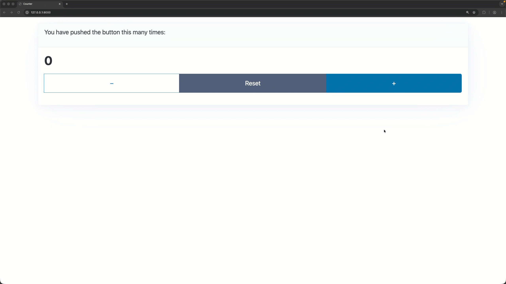

# Django Counter App

Simple counter app built with Django for a YouTube tutorial. Uses Django sessions for state and PicoCSS for styling.



## Features

- Increment, decrement, and reset the counter
- Session-based storage (no database model needed)
- Minimal styling with PicoCSS

## Run locally

```bash
python -m venv .venv
source .venv/bin/activate
pip install -r requirements.txt
cd counter_app
python manage.py migrate
python manage.py runserver
```
